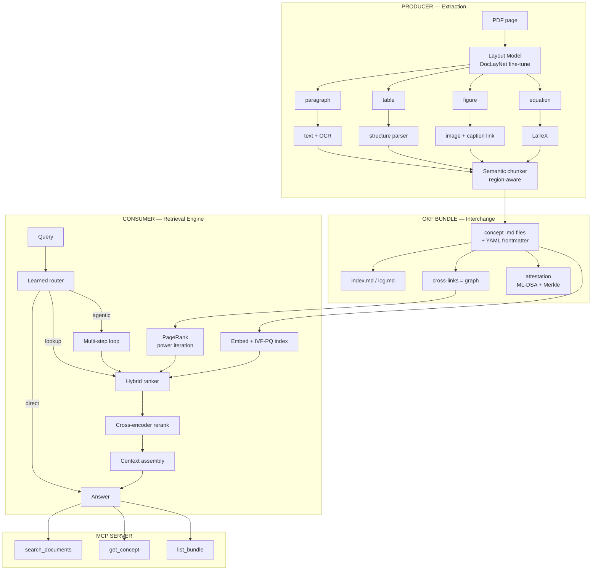

# Implementation Plan — Document Intelligence Platform

**Owner:** Aditya Gupta (2301MC51, B.Tech Mathematics & Computing, IIT Patna)
**Written:** 2026-08-20
**Target:** Placement-ready by 2026-12-20 (16 weeks)
**Constraint:** ~12–15 hrs/week alongside coursework and the ongoing crypto research internship → **~200 effective hours total**

---

## 0. Why this rewrite exists

The current repo is a competent PDF reader with genuinely good geometry/rendering code, but as a placement artifact it has four problems:

| Problem | Evidence | Consequence in an interview |
|---|---|---|
| **Zero ML you trained** | PaddleOCR, MiniLM, ms-marco cross-encoder, Llama 3.1 — all pretrained, all `.predict()` calls | "You integrated models, you didn't build any" |
| **Text-only extraction** | `chunker.ts` splits on `textLen > 800`; tables/figures/equations are destroyed | Product is not actually useful on real papers |
| **Dated retrieval shape** | OCR → fixed chunk → single dense vector → top-k → stuff prompt | Reads as 2023 architecture |
| **No measured numbers** | No eval harness anywhere | Every claim on the resume is unfalsifiable |

Plus one live security bug: [share.ts:232](backend/src/routes/share.ts:232) persists the **raw share token** next to its SHA-256 hash, defeating the hashing entirely.

**The plan below fixes all five and reframes the project around a genuinely current, genuinely open niche.**

---

## 1. The strategic bet

> **Stop shipping "a PDF reader." Ship the retrieval layer that the Open Knowledge Format deliberately leaves unspecified — and expose it over MCP.**

The [OKF spec](https://github.com/GoogleCloudPlatform/knowledge-catalog/blob/main/okf/SPEC.md) (Google Cloud, v0.2, June 2026) standardises knowledge as a directory of Markdown + YAML-frontmatter documents cross-linked into a graph. It explicitly declines to define retrieval:

> *"Consumers must implement their own search or retrieval logic; OKF provides structure but no retrieval infrastructure."*

That gap is the opportunity. The project becomes a clean three-stage pipeline:

```
PDFs  ──►  [ Extraction ]  ──►  OKF bundle  ──►  [ Retrieval Engine ]  ──►  MCP server  ──►  any agent
           multimodal,             portable,          index + rank,           tool API
           layout-aware            git-friendly       agentic loop
```

Why this wins for placements:
- **Competing as "PDF reader" = losing** (Adobe, Zotero, NotebookLM, ChatPDF). Competing as "OKF retrieval + MCP" = an open niche in a two-month-old standard.
- The MCP server is **small, composable, one-command installable** — the only realistic path to real users.
- Every layer maps onto a course you have already done well in.

---

# PART I — SYSTEM DESIGN

*This part is the interview asset. Read it before every interview.*

## 1.1 Current architecture (and what's wrong with it)

```mermaid
graph LR
    A[PDF] --> B[PaddleOCR<br/>Latin + Devanagari]
    B --> C[chunker.ts<br/>split at 800 chars]
    C --> D[MiniLM-L6<br/>384-dim]
    D --> E[(Qdrant)]
    F[Question] --> G[embed]
    G --> E
    E --> H[top-K x 3]
    H --> I[cross-encoder<br/>rerank]
    I --> J[Llama 3.1 8B]
    J --> K[Answer]

    style C fill:#3a1a1a,stroke:#c66
    style H fill:#3a1a1a,stroke:#c66
```



Failure points, in severity order:

1. **`chunker.ts` is layout-blind.** A table split at char 800 becomes two meaningless fragments. A figure caption is orphaned from its figure. An equation becomes garbage tokens.
2. **One vector per chunk.** A 800-char chunk covering three topics gets one 384-dim centroid that represents none of them well.
3. **Fixed top-k with no routing.** "What is this doc about?" and "what's the F1 in Table 3?" take identical, equally-wrong paths.
4. **No provenance.** Answers cite page numbers but nothing records what generated a claim or whether a human checked it.

## 1.2 Target architecture



## 1.3 Component contract table

| Component | Owns | Language | Interface | Fails how |
|---|---|---|---|---|
| **Extractor** | PDF → typed regions | Python | HTTP `/extract` | Degrades to text-only |
| **OKF Emitter** | regions → `.md` bundle | Python | filesystem write | Atomic rename; partial bundle never visible |
| **Attestor** | signatures + Merkle root | Python | `/attest`, `/verify` | Unsigned bundle still readable, flagged untrusted |
| **Index** | vectors → candidates | Python | in-process | Falls back to brute-force scan |
| **Ranker** | candidates → ordered | Python | in-process | Falls back to pure cosine |
| **Router** | query → strategy | Python | in-process | Falls back to `agentic` (safe, slow) |
| **MCP Server** | tool surface | Python | stdio/SSE | Standard MCP error envelope |
| **Reader app** | annotate, view, sync | TS | REST | Offline-first; queues writes |

**Design rule enforced throughout: every component degrades to a working slower path rather than failing.** Be ready to say this sentence in an interview — it's the difference between "I wrote code" and "I designed a system."

## 1.4 Key design decisions (memorise the trade-off columns)

### D1 — Multi-vector late interaction vs. single-vector

| | Single vector (current) | Multi-vector / MaxSim (target) |
|---|---|---|
| Storage per page | 1 × 384 float32 = 1.5 KB | ~256 × 128 = 128 KB raw |
| Scoring | 1 dot product | `Σᵢ maxⱼ ⟨qᵢ, dⱼ⟩` |
| Handles multi-topic chunks | Poorly (centroid collapse) | Well (per-token match) |
| Needs | cheap | PQ compression mandatory |

**Decision:** two-stage funnel — pooled single vector for a cheap top-200 shortlist, MaxSim only on that shortlist. Cost stays near single-vector; quality approaches multi-vector.

### D2 — Own IVF-PQ index vs. Qdrant

| | Qdrant | Own IVF-PQ |
|---|---|---|
| Time to working | hours | ~3 weeks |
| Ops burden | container | none (in-process) |
| **Interview value** | **near zero** | **very high** |
| Correctness risk | low | mine to manage |

**Decision:** build IVF-PQ, **keep Qdrant as the correctness oracle** in the eval harness. Never claim you beat Qdrant on speed — claim you matched its recall at a measured compression ratio, and that you can derive every step.

> **The math to own:** coarse quantizer = K-means over the vector space (MA2201). Product quantization = K-means run independently on each of `m` subvector blocks. 384-dim float32 = 1536 B → 48 subquantizers × 1 byte = **48 B ⇒ 32× compression**. Asymmetric Distance Computation precomputes a `m × 256` lookup table per query, then each candidate distance is `m` table lookups and adds — **no multiplies in the inner loop**, and the table is sized to sit in L1 (MA2204).

### D3 — Retrieval strategy routing

| Strategy | Latency | Use when |
|---|---|---|
| `direct` | ~0 ms retrieval | Query is about the open document, already in context |
| `lookup` | 20–50 ms | Factual, single-hop, entity-anchored |
| `graph` | 50–100 ms | "related to", "what depends on X" |
| `agentic` | 2–10 s | Multi-hop, comparative, synthesis |

**Decision:** learned classifier picks the strategy; unknown/low-confidence → `agentic` (correct but slow). **Fail toward correctness, not speed.**

### D4 — Storage layout

```
bundle/
  index.md              # progressive disclosure (OKF reserved)
  log.md                # chronological history (OKF reserved)
  concepts/
    <doc>/
      p003-methodology.md
      p004-table-results.md
  references/
    figures/f0034.png
  .okfidx/              # OUR extension, not in spec — regenerable cache
    vectors.pq          # PQ codes
    centroids.npy       # IVF coarse centroids
    graph.json          # adjacency for PageRank
    merkle.json         # attestation tree
```

**Invariant:** deleting `.okfidx/` must lose nothing but time. The bundle is the source of truth; the index is a cache. Say this in interviews — it's the same source-of-truth/derived-data distinction as a DB index over a heap file (MA2205).

## 1.5 Capacity estimation (interviewers *will* ask)

Assume the realistic target: **1 user, 500 PDFs, ~200 pages each = 100,000 pages.**

```
Regions per page          ~8      → 800,000 regions
Concepts (merged)         ~3/page → 300,000 concept docs
Markdown on disk          ~2 KB   → 600 MB
Pooled vectors  300k × 384 × 4 B  → 460 MB   (too big for comfort)
       ...with PQ @ 48 B          →  14 MB   ✅ fits in RAM trivially
Multi-vector 300k × 64 × 128 × 1B →   2.4 GB  (on disk, mmap'd)
IVF probing: √300k ≈ 550 lists, nprobe=16 → ~8,700 candidates scanned/query
```

**Latency budget (target p95 for `lookup`):**

| Stage | Budget |
|---|---|
| Embed query | 8 ms |
| IVF coarse (550 centroid dots) | 1 ms |
| PQ ADC over 8.7k candidates | 6 ms |
| MaxSim rerank on top-200 | 15 ms |
| Cross-encoder on top-20 | 25 ms |
| **Total** | **~55 ms** |

Scaling path to 10M pages: centroids → 3,000 lists; vectors exceed RAM → mmap + OS page cache (MA3105 demand paging — **that connection is worth stating out loud**); shard by `docId` with a coordinator doing scatter-gather.

## 1.6 Failure mode analysis

| Failure | Detection | Response |
|---|---|---|
| Crash mid-annotation | WAL replay on open | Recover to last committed op |
| Corrupt PQ index | Merkle root mismatch | Rebuild from bundle |
| Layout model wrong on a page | Confidence < τ | Fall back to raw text extraction |
| Router misroutes | Confidence < τ | Escalate to `agentic` |
| Bundle tampered | Signature verify fails | Serve, mark `trust: unverified` |
| LLM unreachable | Timeout | Return ranked passages without synthesis |

---

# PART II — PHASED IMPLEMENTATION

**Legend:** 🔴 Core (do not cut) · 🟡 High value · 🟢 Stretch

## Phase 0 — Foundation & measurement 🔴
**Weeks 1–2 · ~25 hrs**

You cannot improve what you cannot measure, and you cannot demo a repo with a live security bug.

**Tasks**
1. **Fix the share-token bug.** Stop persisting `rawToken`; return it once at creation, store only the SHA-256. Add a test that asserts no raw token exists in Firestore after creation.
2. **Delete dead weight.** Remove the vestigial collab UI (`CollabUserList.tsx`, `collab-store.ts`), stub `ingest/index.ts` (currently returns 501), and rewrite `README.md` — it still advertises Y.js collaboration and an AWS Lambda pipeline that no longer exist. **An interviewer who clones this repo must not find advertised features missing.**
3. **Build the eval harness** (`eval/`): 150–200 hand-labeled `(query, relevant_concept_ids)` pairs over ~20 real papers. Metrics: Recall@k, MRR, nDCG@10.
4. **Add statistical rigor** — bootstrap 95% CIs on every metric, paired t-test for A/B comparisons (MA3203).
5. **Record the baseline.** Run the current pipeline through the harness. This number is your "before" for every claim you make for the next four months.

**Acceptance:** `python eval/run.py --config baseline` prints nDCG@10 with a CI. Committed to git as `eval/results/baseline.json`.

> ⚠️ Do not skip or shorten Phase 0. Every impressive number in Phases 1–6 is worthless without it, and "I measured before I optimised" is itself a strong signal.

---

## Phase 1 — Multimodal extraction + ML model #1 🔴
**Weeks 3–5 · ~40 hrs**

Fixes the biggest functional gap (text-only) and gives you your first trained model.

**Tasks**
1. **Region proposals.** Start with a pretrained document layout detector for bounding boxes. This is scaffolding, not the deliverable.
2. **Train the region classifier — this is your ML deliverable.** Fine-tune a ResNet-18/34 backbone on **DocLayNet** region crops → `{title, paragraph, table, figure, caption, equation, list, page-header/footer}`.
   - Transfer learning, frozen-then-unfrozen backbone (you have this skill)
   - Class-imbalance handling (weighted loss — `paragraph` massively dominates)
   - **Optuna** for LR / weight-decay / unfreeze-depth
   - Report per-class precision/recall + confusion matrix, not just accuracy
3. **Typed handlers per region.** Tables → structured rows/cols. Figures → crop + link to nearest caption. Equations → LaTeX. Text → existing OCR path.
4. **Reading-order resolution.** Build a DAG over regions (above/left-of constraints) and topological-sort it (MA2101/MA2105). Handles two-column papers, which currently interleave into nonsense.
5. **Replace `chunker.ts`.** Chunk on region boundaries, never mid-table, never orphaning a caption.

**Measure:** classifier macro-F1; extraction quality on a 20-doc holdout; **re-run Phase 0 eval** — retrieval should improve purely from better chunking. Report the delta with a CI.

**Resume line:**
> *Fine-tuned a ResNet-34 document-layout classifier (PyTorch, DocLayNet, Optuna-tuned) to macro-F1 X across 8 region classes; built typed extraction handlers and DAG-based reading-order resolution, improving retrieval nDCG@10 from A to B (95% CI [·,·]).*

---

## Phase 2 — OKF emitter + retrieval engine 🔴
**Weeks 6–9 · ~50 hrs**

The core differentiator. Two halves: produce OKF, then build the retrieval OKF omits.

### 2a — OKF emitter (week 6)
- Emit spec-conformant concepts: required `type`; recommended `title`, `description`, `resource`, `tags`
- Populate `sources` provenance, `generated: {by, at}` using OKF's actor convention (`process:extractor/v1`), `status`, `stale_after`
- Generate reserved `index.md` (progressive disclosure) and `log.md` (history)
- Cross-link concepts: section→parent doc, figure→caption, table→discussing section. **These links become the retrieval graph in 2c.**
- Atomic bundle writes (temp dir + rename) so a partial bundle is never observable

### 2b — IVF-PQ index from scratch (weeks 7–8) 🟡
- K-means coarse quantizer (`nlist ≈ √N`), inverted lists
- Product quantization: `m=48` subquantizers, 256 centroids each, K-means per block
- Asymmetric Distance Computation with per-query LUT
- `nprobe` sweep → **plot the recall/latency Pareto curve** (this plot is a portfolio item)
- Validate against brute-force and against Qdrant on identical vectors

### 2c — Graph ranking (week 9)
- Build adjacency from OKF cross-links
- **PageRank via power iteration** — damping 0.85, L1 convergence threshold, report iteration count
- Blend: `score = α·semantic + β·pagerank + γ·freshness` (freshness from OKF `status`/`stale_after`/`last_modified`)
- Tune `α, β, γ` on the eval set — this is a small constrained optimisation (MA2103/MA3204)

> **Own this math:** PageRank is the dominant eigenvector of the column-stochastic link matrix; power iteration converges at rate `|λ₂/λ₁|`; damping is a rank-one perturbation that makes the chain irreducible and aperiodic, guaranteeing a unique stationary distribution (MA2102 Markov chains + MA2203 numerical LA). **If you can say this cleanly you will out-answer most candidates in the room.**

**Resume line:**
> *Implemented the retrieval layer left unspecified by Google's Open Knowledge Format: an IVF-PQ vector index built from scratch (K-means coarse quantizer + product quantization, 32× memory compression at N% recall@10) fused with PageRank computed by power iteration over the OKF concept graph.*

---

## Phase 3 — MCP server + agentic retrieval + ML model #2 🔴
**Weeks 10–11 · ~30 hrs**

The "wow" demo and your realistic shot at real users.

**Tasks**
1. **MCP server** exposing: `search_documents`, `get_concept`, `list_bundle`, `get_figure`, `verify_bundle`. Clean tool schemas, scoped capabilities, structured errors.
2. **Learned query router (ML model #2).** Label ~500 queries by strategy. Baseline: TF-IDF + logistic regression (MA2201). Upgrade: fine-tuned MiniLM classification head. **Report the latency win** — this is a real, honest, quotable number.
3. **Agentic retrieval loop.** Decompose → sub-queries → sufficiency critique → re-query, with a hard step budget and cost ceiling. Log the full trace (this trace is a fantastic demo artifact).
4. **Context assembly** replacing naive top-k stuffing: dedupe, order by reading order not score, include structural context (parent section title), respect a token budget.

**Acceptance:** install the MCP server in Claude Desktop / any MCP client, ask a question about your own paper library, get a cited answer. **Record this demo.**

**Resume line:**
> *Shipped an MCP server exposing a 100k-page OKF corpus to any agent; a learned query router (fine-tuned MiniLM) selects among direct/lookup/graph/agentic strategies, routing N% of queries to a sub-50ms path and cutting median latency Xx.*

---

## Phase 4 — Post-quantum attestation 🟡
**Weeks 12–13 · ~25 hrs**

Your unique differentiator. Nobody else in your placement cohort can talk about this.

**The gap:** OKF v0.2 defines `verified: [{by: "human:aditya", at: ...}]` and derives a trust tier from the `human:` string prefix — with **no cryptographic enforcement whatsoever**. Anyone can hand-edit the Markdown and claim human verification.

**Tasks**
1. Canonical serialisation of a concept doc (frontmatter ordering, whitespace, line endings) → stable content hash. *Getting canonicalisation right is the whole problem; be ready to explain why.*
2. Merkle tree over bundle concepts → single signed root. Inclusion proofs for individual concepts.
3. **Sign with ML-DSA (Dilithium)** via `liboqs`, in **hybrid** with Ed25519 — hybrid is the correct migration posture and shows you understand deployment, not just primitives.
4. `verify_bundle` MCP tool + trust tiers surfaced in results (`verified-human` / `verified-process` / `unverified` / `tampered`).
5. **Write it up as a short spec proposal** and open a GitHub issue/discussion on the OKF repo.

> **Use libraries for the primitives. Never hand-roll crypto.** Your contribution is the *protocol design* — canonicalisation, tree construction, trust model, migration path.

**Resume line:**
> *Designed and implemented a post-quantum attestation layer for OKF bundles — canonical serialisation, Merkle-root integrity, and hybrid Ed25519 + ML-DSA (Dilithium) signatures — closing an unenforced-trust gap in the v0.2 spec; submitted as a spec proposal upstream.*

This bullet plus your research internship makes a coherent, unusual crypto narrative.

---

## Phase 5 — Systems depth: WAL + crash recovery 🟡
**Week 14 · ~15 hrs**

Your strongest "systems engineer" signal, and it fixes a real bug (crash = lose the session).

- Append-only operation log; `fsync` policy you can defend
- Periodic checkpoint + compaction
- Replay-on-open recovery; idempotent ops so replay is safe
- Merkle-chain log entries (`H(prev ‖ entry)`) → tamper-evident history, reusing Phase 4 machinery
- **Test by actually killing the process mid-write** and asserting recovery

Maps to MA2205 (WAL, ARIES-style recovery, checkpointing), MA3105 (durability, `fsync`, crash consistency), MA3201 (hash chains).

---

## Phase 6 — Client-side + ML model #3 🟢
**Weeks 15–16 · ~15 hrs**

Optional, but you said an interviewer would appreciate it — and this is the *demoable* one.

- **Sketch recognition (ML #3):** BiLSTM over stroke sequences trained on **Google QuickDraw** (format already matches your `(x, y, t)` capture). Preprocessing reuses your existing RDP + arc-length resampling + normalisation. Ship as live sketch-beautification.
- Surface region types in the reader (tables selectable as tables, figures as figures)
- Show trust tier and citations in the chat sidebar
- Multi-device CRDT sync (**not** multi-user collab — you were right to reject that) if and only if time remains

---

## 2.7 Schedule at a glance

| Wk | Phase | Deliverable | Cut? |
|---|---|---|---|
| 1–2 | 0 | Security fix, cleanup, eval harness + baseline | 🔴 never |
| 3–5 | 1 | Layout classifier, typed extraction, reading order | 🔴 never |
| 6 | 2a | OKF emitter | 🔴 never |
| 7–8 | 2b | IVF-PQ from scratch | 🟡 → fall back to Qdrant |
| 9 | 2c | PageRank + hybrid ranking | 🟡 |
| 10–11 | 3 | MCP server, router, agentic loop | 🔴 never |
| 12–13 | 4 | PQC attestation | 🟡 |
| 14 | 5 | WAL + recovery | 🟡 |
| 15–16 | 6 | Sketch ML, client polish, demo video | 🟢 |

**If you fall behind, cut in this order:** 6 → 5 → 2b → 4. **Never cut 0, 1, 2a, or 3** — those four are the coherent product story.

---

# PART III — INTERVIEW PREPARATION

## 3.1 The two resume entries this produces

**Entry A — Document Intelligence & Retrieval Engine** *(lead with this for ML/AI roles)*
Layout classifier · typed multimodal extraction · OKF emitter · IVF-PQ index · PageRank ranking · learned router · agentic retrieval · MCP server

**Entry B — Offline-First Storage & Sync Engine** *(lead with this for SDE/systems roles)*
WAL + crash recovery · Merkle-chained history · post-quantum attestation · content-addressed save protocol with optimistic concurrency · quadtree spatial index · capsule-intersection eraser

Two focused entries read far stronger than one sprawling project, and let you re-order by role.

## 3.2 Questions you will be asked — prepare cold

**On the ML**
- Why ResNet and not a transformer backbone? What would ViT change?
- Your classes are imbalanced — what did you do, and how did it change per-class recall?
- Why macro-F1 rather than accuracy?
- Optuna searched what space, and what did it actually find?

**On the retrieval**
- Derive product quantization. Why does ADC not need the query quantized?
- Why is PQ error acceptable for ranking but not for exact search?
- How do you pick `nlist` and `nprobe`? Show me the Pareto curve.
- PageRank: why damping? What's the convergence rate? What if the graph is disconnected?
- Why not just use a vector DB? *(Correct answer: for production I would; I built it to understand the layer, and I validate against Qdrant.)*

**On the systems**
- Walk me through crash recovery, step by step.
- Why WAL instead of just writing the file?
- Optimistic vs. pessimistic concurrency — why did you pick optimistic *here*?
- What breaks first at 100× scale?

**On the crypto**
- Why hybrid Ed25519 + ML-DSA instead of ML-DSA alone?
- Why is canonicalisation the hard part of signing a document?
- What attack does the Merkle root prevent that per-document signing does not?

**On the geometry (existing work)**
- Derive point-to-segment distance. Explain the two clamp cases. *(Highest-value 20 minutes of prep you can spend — it's pure vector projection from MA1101.)*
- Why RDP before Catmull-Rom? What does ε control?
- Why quadtree over a uniform grid?

## 3.3 Rules for talking about this project

1. **Never claim you replaced RAG.** Say: *"I kept retrieval but replaced the 2023 shape of it — layout-aware extraction instead of fixed chunks, multi-vector late interaction instead of a single centroid, learned routing and an agentic loop instead of fixed top-k, and OKF for portable provenance."* That is accurate and it is current.
2. **Never quote a number you did not measure.** Every figure comes from `eval/` with a CI.
3. **Volunteer the limitations.** "IVF-PQ is slower than Qdrant's HNSW at this N; I built it to own the layer, and I validate recall against Qdrant." Volunteering a weakness reads as confidence and gets rewarded.
4. **Say "I don't know" cleanly, then reason.** Far better than bluffing.
5. **Lead with the design decision, not the technology.** "I needed to fail toward correctness, so the router escalates on low confidence" beats "I used MiniLM."

## 3.4 Ownership discipline

You identified your own gap: past projects leaned on AI assistance, and you want to be able to explain, modify, and extend everything.

Enforce these three rules and the gap closes by December:

- **The whiteboard test.** If you cannot reproduce a component's core algorithm on paper without notes, you do not list it on your resume.
- **`docs/decisions/` — one short ADR per non-obvious choice.** What you chose, what you rejected, why. Writing it is how you find out whether you actually understood it. It's also a strong artifact to show.
- **Explain-before-commit.** Before committing any non-trivial algorithm, write a 5-line comment deriving *why it is correct*. If you can't, you don't understand it yet.

## 3.5 Realistic expectations

- **200 hours is genuinely tight for this scope.** The phase-cut order exists because you will likely use it. Cutting Phase 5 to finish Phases 0–3 well is a *good* outcome; half-finishing all six is a bad one.
- **"Real users" is a stretch goal, not a plan.** The MCP server is your most plausible shot because it's small and installable. Ship it publicly, post it where OKF adopters gather, and treat any adoption as upside — do not let user acquisition compete with placement prep.
- **Depth beats breadth in interviews.** Three components you can derive on a whiteboard will out-perform seven you can only describe.

---

## Immediate next actions

1. `git checkout -b v2-okf` — keep `main` working and demoable at all times
2. Fix [share.ts:232](backend/src/routes/share.ts:232)
3. Rewrite `README.md` to describe what the repo *actually contains*
4. Create `eval/` and start labeling queries — target 50 by end of week 1
5. Create `docs/decisions/0001-okf-as-interchange-format.md` as the first ADR

**Do not start Phase 1 until the Phase 0 baseline number is committed to git.**
