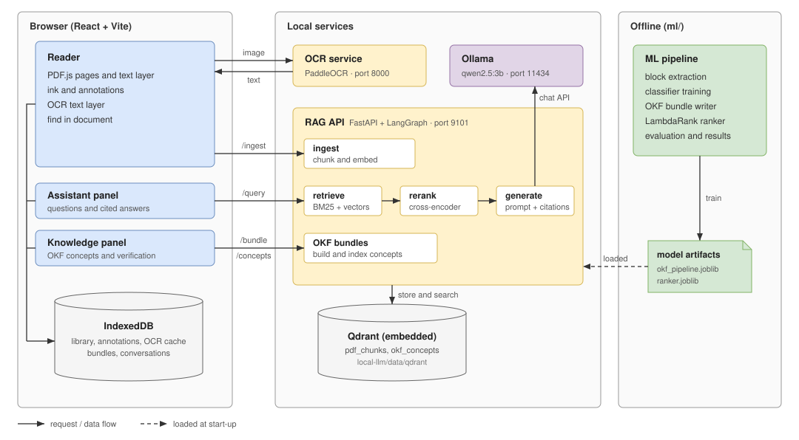

# Margin

Margin is a local-first PDF reading and annotation workspace for mathematical
documents. The browser stores the library and edits locally. Optional Python
services build Open Knowledge Format (OKF) concept bundles and provide a local
retrieval-augmented assistant.

**Status, October 19, 2026:** ML1–ML5 implementation and experiments are
complete, and ML7 documents their results. ML6's calibrated answerability
gate is optional and has not been implemented. Manual acceptance of earlier
reader/chrome changes and static-demo publication remain open. Experimental
completion does not establish deployment-ready answer quality.

## Architecture



The browser app keeps every document, annotation, bundle and conversation in
IndexedDB. Two optional local services do the heavy work: the OCR service
(port 8000) and the RAG API (port 9101), which indexes passages and OKF
concepts in an embedded Qdrant store and answers questions through Ollama.
The `ml/` track trains the block classifier and ranker offline; the service
loads their saved artifacts at start-up.

## Reader and knowledge tools

- Read PDFs in tabs and split panes; keep a local library in IndexedDB.
- Annotate with ink, highlights, text, shapes and math; use shared undo/redo,
  page operations, notes and PDF/Markdown export.
- Find literal, case-insensitive strings in native PDF text, with page bounds.
  The current find implementation has no OCR or semantic-search fallback.
- Build an OKF bundle, inspect linked concepts, jump to their PDF regions,
  mark a concept verified and export its Markdown bundle.
- Ask the optional local assistant over indexed passages and concepts.
  Citations aid inspection; they do not guarantee a correct or supported answer.

The reader does not need a Python service. The Knowledge panel needs `/bundle`;
chat additionally needs embeddings, retrieval/reranking and a running local
LLM. OCR code and a separate service remain in the repository; current find
and the ML evaluation use native text. Scanned-PDF ML/OCR acceptance is outside
the completed evaluation.

## Run the reader

From the repository root, with Node.js/npm installed:

```powershell
npm ci
npm run dev
```

Open the URL printed by Vite. `npm run build` builds the reader;
`npm run preview` serves that build. The static demo is separate:

```powershell
npm run build:demo
npm run demo:check
```

The demo does not provide OCR, ingestion, Knowledge or assistant services.
Historical Firebase/Express environment examples are not required for the
local reader. Export important documents/annotations before clearing browser
site data; IndexedDB is local storage, not a remote backup.

## Optional local services

Run Python commands from the repository root. The recorded development
environment is Python 3.13.2 with `.venv-ml`; dependency files are not a complete
platform lockfile. For a fresh ML/service environment:

```powershell
py -3.13 -m venv .venv-ml
.\.venv-ml\Scripts\python.exe -m pip install -r ml/models/requirements.txt -r ml/eval/requirements.txt -r local-llm/rag-api/requirements.txt
```

Existing installations should keep their verified environment rather than
reinstall it. Model weights may download on first use; offline operation
requires those cached weights and the relevant local artifacts first.
Training, building bundles and model-backed evaluation consume CPU/RAM;
schedule them explicitly on a shared laptop. This README does not run them.

For Knowledge tools alone, with the local OKF artifact already available:

```powershell
.\.venv-ml\Scripts\python.exe -m uvicorn bundle_server:app --app-dir local-llm/rag-api --host 127.0.0.1 --port 9101
```

For chat, open the Ollama app (once: `ollama pull qwen2.5:3b-instruct`), then
start the full service **instead of** the bundle-only server:

```powershell
npm run assistant
```

The script checks that Ollama and the model are available (it never starts
Ollama) and runs the service on port 9101. The assistant panel shows which
part is missing: the service, Ollama, or the model. The equivalent manual
command, with the defaults spelled out:

```powershell
$env:RETRIEVAL = 'hybrid_concepts'
$env:RERANK = 'cross_encoder'
$env:LLM_BASE_URL = 'http://localhost:11434/v1'
$env:LLM_MODEL = 'qwen2.5:3b-instruct'
.\.venv-ml\Scripts\python.exe -m uvicorn main:app --app-dir local-llm/rag-api --host 127.0.0.1 --port 9101
```

Both entry points use port 9101; run one. The full service can load the
embedder at startup through its validator. No Docker, Typesense or external
Qdrant server is required by this local path. With `QDRANT_URL` unset, Qdrant
uses `local-llm/data/qdrant`; only one client/process may own that folder.
Loopback services have no user-account authentication; keep this single-user
setup local. Server endpoints and model URLs can be configured, so local data
handling depends on keeping those defaults local.

`/bundle` requires `ml/models/artifacts/okf_pipeline.joblib`. The learned-ranker
option uses `ml/models/artifacts/ranker.joblib`; neither artifact is committed.
Raw PDFs, quoted labels/questions and generated answers are also excluded.
See the cards for artifact identities and reproduction constraints.

## Architecture

```text
React 19 + TypeScript + Vite + PDF.js
  src/core/        pure decisions, geometry and command semantics
  src/lib/         browser, PDF and storage adapters
  IndexedDB        library, annotations/OCR cache and knowledge bundles
  local Python :9101
    /bundle        trained block pipeline -> OKF concepts and links
    /ingest        native PDF chunks -> embeddings -> embedded Qdrant
    /query         hybrid BM25 + dense + OKF -> cross-encoder -> local Qwen
```

The ML track trains a block-role/definition pipeline and a LambdaRank
reranker. It does **not** train the pretrained embedder, cross-encoder or
Qwen LLM. Retrieval ranking, generated-answer quality and latency are
measured separately. There is no account, cloud synchronization or Node
application backend. Older container/cloud plans are historical alternatives.

## Measured results

The frozen retrieval milestone scores 127 answerable questions from the
original/independent collections over six shared PDFs; 31 unsupported
questions are counted separately. Pooled cross-encoder Recall@5/MRR@10/
page nDCG@10 are **0.9528 / 0.8311 / 0.8509**. Ranker MRR difference is
**-0.0029 [95% CI -0.0551, +0.0385]** and fails the fixed switch rule.
Keep hybrid + OKF concepts + cross-encoder. Concepts improve pooled CE MRR
versus passages by **+0.0370 [+0.0040, +0.0742]** on this sample.

All 100 saved-context answers were assistant-reviewed: CE/ranker mean
correctness **1.76/1.80 out of 2**, paired **+0.04 [-0.20, +0.275]**.
There is no demonstrated answer-quality improvement. One reviewer, partial
blinding, AI-authored cases and few documents limit generalization. Factual,
mathematical and citation errors remain. Successful frozen generation took
**136.7 s mean / 117.9 s median per request**; this is not an acceptable
interactive-latency claim. Faster TRAIN context variants remain deferred
because they caused correctness regressions.

Read the [final results](docs/ML7_RESULTS.md), [model card](docs/MODEL_CARD.md),
[dataset card](docs/DATASET_CARD.md) and [ML5 decision log](docs/ML5_SYNTHESIS.md)
for intervals, denominators, provenance and limitations.

## Checks and project map

```powershell
npm test
npm run build
.\.venv-ml\Scripts\python.exe -m pytest ml/tests -q -p no:cacheprovider
node --test ml/tests/grading_session.test.cjs
```

The latest full ML check passed **532 tests**; six grading-session tests also
passed. A missing Windows `wmic` physical-core query produced one investigated
joblib warning with logical-core fallback. Restricted Windows test environments
may need permission for asyncio's internal socket pair. These checks use stubs
or small fixtures, not a new model-backed benchmark. UI interaction/visual
acceptance is performed by the user and remains distinct from unit tests.

- `src/`: reader UI, pure core and browser adapters.
- `local-llm/rag-api/`: optional local bundle, ingest and query service.
- `ml/data/`, `ml/models/`, `ml/okf/`, `ml/ranking/`: training and inference code.
- `ml/eval/`, `ml/tests/`, `ml/results/`: guarded experiments, tests and aggregates.
- [Roadmap](docs/IMPLEMENTATION_PHASES.md) and [implementation log](docs/implementation_log.md).

Frozen evaluations are consumed and must not be rerun or used for tuning.
Model-backed workloads require explicit laptop approval; do not start Ollama
automatically. See the dataset card before reproducing any historical command.
